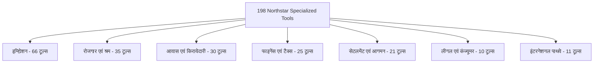

# Northstar Settlement Intelligence — विस्तृत प्रोजेक्ट KB एवं टूल्स ऑडिट रिपोर्ट

**तिथि: 6 नवंबर 2026 | वर्शन: v0.19.67 | कुल टूल्स: 198 | SQLite KB रिकॉर्ड्स: 1,221 | फोरम प्रश्न कॉर्पस: 100,000**

---

## 1. प्रोजेक्ट आर्किटेक्चर एवं कार्यप्रणाली का सार (Executive Summary)

नॉर्थस्टार (Northstar) एक **Settlement & Global Immigration Intelligence** प्लेटफार्म है जो नए प्रवासियों (newcomers), अस्थायी विदेशी कामगारों (TFWs), अंतरराष्ट्रीय छात्रों और प्रवासियों को कनाडा और प्रमुख वैश्विक अधिकार-क्षेत्रों (Jurisdictions) में बसने, कानूनी अधिकार समझने, आवास (Housing), रोजगार (Employment), टैक्स और स्वास्थ्य सेवाओं में मार्गदर्शन देने के लिए डिज़ाइन किया गया है।

### प्रोजेक्ट की मुख्य संरचना:
1. **कोर इंजन (`src/engine.js`)**: डिटरमिनिस्टिक इंटेंट पार्सिंग, लेक्सिकल BM25 रैंकिंग, भौगोलिक फ़िल्टरिंग (Geographic scoping), और सख्त प्रूवेनेंस (Provenance) गेट्स पर आधारित।
2. **ज्ञान का आधार (Knowledge Bases)**:
   - **SQLite KB (`data/settlement.sqlite`)**: 1,221 रिकॉर्ड्स, 1,162 सोर्स। 15 मुख्य विषयों में विभाजित।
   - **रिसर्च सीड्स (`src/knowledge.js`)**: 258 प्री-बिल्ट रिकॉर्ड्स (20 लो-रिस्क, 238 हाई-रिस्क)।
   - **फोरम प्रश्न कॉर्पस (`corpus/`)**: Reddit (r/ImmigrationCanada, r/legaladvicecanada), Quora, LinkedIn और सेटलमेंट बोर्ड्स के वास्तविक प्रश्नों पर आधारित **100,000 प्रश्नों का भंडार** (5 डेटासेट फाइलों में 20,000-20,000 प्रश्न)।
3. **198 स्पेशलाइज्ड टूल्स**: 7 बड़े डोमेन राउटर्स में विभाजित कानूनी और स्टेट्यूटरी कैलकुलेटर।

---

## 2. कौन-कौन से टॉपिक कवर हो रहे हैं? (Topic Coverage Analysis)

प्रोजेक्ट के नॉलेज बेस (`settlement.sqlite`) में कुल **15 मुख्य विषय (Topics)** पंजीकृत हैं, जिनमें 1,221 आधिकारिक और रिसर्च रिकॉर्ड्स हैं:

| क्र.सं. | टॉपिक कोड | कुल रिकॉर्ड्स | अप्रूव्ड (Approved) | पेंडिंग (Pending) | रिजेक्टेड (Rejected) | मुख्य कवरेज क्षेत्र (Coverage Focus) |
|---|---|---|---|---|---|---|
| 1 | `community` | 253 | 248 | 0 | 5 | न्यूकमर वेलकम सेंटर्स, कम्युनिटी सर्विसेज, 211 डायरेक्टरी |
| 2 | `driving` | 236 | 236 | 0 | 0 | ड्राइविंग लाइसेंस एक्सचेंज, 201 देश, G1/G2/G नियम, रोड टेस्ट |
| 3 | `housing` | 171 | 169 | 0 | 2 | रेजिडेंशियल लीज, RTA/RTB अधिकार, किराया वृद्धि, बेदखली नोटिस |
| 4 | `employment` | 161 | 154 | 0 | 7 | न्यूनतम वेतन, ओवरटाइम, ESA नियम, अवैध कटौतियां, वर्क रिफ्यूजल |
| 5 | `health` | 103 | 103 | 0 | 0 | OHIP, BC MSP, क्लिनिक एक्सेस, IFHP शरणार्थी कवरेज, वेटिंग पीरियड |
| 6 | `money` | 92 | 91 | 1 | 0 | फर्स्ट टैक्स रिटर्न, CRA खाते, बैंकिंग, मूविंग डिडक्शन |
| 7 | `transit` | 56 | 42 | 0 | 14 | TTC (Toronto), TransLink (BC), MiWay, Brampton Transit पास |
| 8 | `family` | 32 | 32 | 0 | 0 | स्पॉउसल स्पॉन्सरशिप, चाइल्ड बेनिफिट्स (CCB), कस्टडी डॉक्युमेंट्स |
| 9 | `sin` | 24 | 21 | 0 | 3 | सर्विस कनाडा SIN आवेदन, आवश्यक पहचान पत्र, स्टेटस वैलिडेशन |
| 10 | `schooling` | 21 | 21 | 0 | 0 | TDSB, VSB, Peel स्कूल बोर्ड्स में बच्चों का एडमिशन नियम |
| 11 | `arrival` | 21 | 19 | 0 | 2 | पोर्ट ऑफ एंट्री (POE) प्रक्रिया, पहले हफ्ते की आधिकारिक चेकलिस्ट |
| 12 | `childcare` | 19 | 18 | 1 | 0 | CWELCC $10-a-day डेकेयर, सिटी सब्सिडी, TELCCS |
| 13 | `telecom` | 17 | 17 | 0 | 0 | मोबाइल अनुबंध, CCTS शिकायत प्रक्रिया, डिवाइस अनलॉकिंग |
| 14 | `groceries` | 14 | 12 | 0 | 2 | BCCDC एवं ONFB खाद्य बास्केट मूल्य बेंचमार्क, फूड बैंक्स |
| 15 | `education` | 1 | 1 | 0 | 0 | फॉरेन क्रेडेंशियल असेसमेंट (ECA / WES) ओवरव्यू |

> [!WARNING]
> **गहराई की भौगोलिक सीमा**: डेटाबेस का 80% विस्तार केवल **चार पायलट शहरों** (Toronto, Vancouver, Mississauga, Brampton) और दो प्रांतों (Ontario, British Columbia) पर केंद्रित है। अल्बर्टा, क्यूबेक, मैनिटोबा और सस्केचेवान के कई विषय अभी भी डेटा-गैप में हैं।

---

## 3. कौन-कौन से टूल्स कवर हो रहे हैं? (198 Tools Coverage)

सिस्टम में कुल **198 एंडपॉइंट्स (Tools)** हैं, जो 7 डोमेन राउटर्स में विभाजित हैं:



### 1. इमिग्रेशन (Immigration — 66 Tools)
- **स्कोर व पाथवे**: `/v1/tools/express-entry-crs`, `/v1/tools/pnp-pathway`, `/v1/tools/bc-pnp-tech`, `/v1/tools/sinp-tech-talent`, `/v1/tools/alberta-opportunity-stream`, `/v1/tools/atlantic-immigration`, `/v1/tools/start-up-visa`
- **परमिट्स व अनुपालन**: `/v1/tools/pgwp-eligibility`, `/v1/tools/sowp-eligibility`, `/v1/tools/bowp-diagnostic`, `/v1/tools/study-permit-cap-pal`, `/v1/tools/tfw-compliance`, `/v1/tools/vulnerable-worker`, `/v1/tools/border-flagpoling`
- **नागरिकता व पीआर सुरक्षा**: `/v1/tools/citizenship-calculator`, `/v1/tools/pr-residency`, `/v1/tools/medical-admissibility`, `/v1/tools/criminal-rehab`, `/v1/tools/trp-inadmissibility`, `/v1/tools/refugee-cessation`

### 2. रोजगार व श्रमिक अधिकार (Employment & Labour — 35 Tools)
- **वेतन व चोरी**: `/v1/tools/worker-classification` (कांट्रैक्टर बनाम कर्मचारी ऑडिट), `/v1/tools/statutory-pay`, `/v1/tools/esa-wage-theft`, `/v1/tools/ontario-public-holiday-pay`, `/v1/tools/bc-overtime-banking`
- **बर्खास्तगी व नोटिस**: `/v1/tools/severance-bardal` (कॉमन लॉ नोटिस कैलकुलेटर), `/v1/tools/severance-reasonable-notice`, `/v1/tools/alberta-just-cause`, `/v1/tools/bc-esa-group-termination`
- **सुरक्षा व प्रतिशोध**: `/v1/tools/workplace-safety`, `/v1/tools/workplace-rights`, `/v1/tools/esa-reprisal-defense`, `/v1/tools/ei-benefits`, `/v1/tools/digital-platform-worker`

### 3. आवास व किरायेदार सुरक्षा (Housing & Tenancy — 30 Tools)
- **किराया व बेदखली**: `/v1/tools/lease-guard`, `/v1/tools/eviction-defense` (N12/N13 ऑडिट), `/v1/tools/rent-increase-defense`, `/v1/tools/bc-landlord-use-eviction`
- **मरम्मत व विवाद**: `/v1/tools/tenancy-repairs`, `/v1/tools/ontario-residential-tenancy-urgent-repairs-t6`, `/v1/tools/bc-rtb-dispute-track`, `/v1/tools/ontario-illegal-entry-t2`
- **डिपॉजिट व स्ट्रैटा**: `/v1/tools/alberta-security-deposit`, `/v1/tools/bc-security-deposit-double-penalty`, `/v1/tools/bc-strata-bylaw`, `/v1/tools/ontario-roommate-rights`

### 4. फाइनेंस एवं टैक्स (Finance & Benefits — 25 Tools)
- `/v1/tools/credit-simulator`, `/v1/tools/cra-benefits`, `/v1/tools/moving-tax-calc`, `/v1/tools/childcare-subsidy`, `/v1/tools/cross-border-tax`, `/v1/tools/speculation-tax-rebate`, `/v1/tools/cra-newcomer-wealth` (T1135 फॉरेन एसेट ऑडिट)

### 5. सेटलमेंट एवं आगमन (Settlement & Integration — 21 Tools)
- `/v1/tools/compare-cities`, `/v1/tools/settlement-journey`, `/v1/tools/licence-exchange`, `/v1/tools/credential-pathway`, `/v1/tools/language-score-clb`, `/v1/tools/customs-declaration`, `/v1/tools/vehicle-import`

### 6. लीगल एवं उपभोक्ता संरक्षण (Legal & Consumer — 10 Tools)
- `/v1/tools/telecom-contract-defense` (CCTS सेलफोन अनुबंध कैंसलेशन), `/v1/tools/debt-collection-defense`, `/v1/tools/human-rights-defense`, `/v1/tools/small-claims`

### 7. इंटरनेशनल पाथवे (International — 11 Tools)
- `/v1/tools/global-visa-matrix`, `/v1/tools/us-h1b-opt`, `/v1/tools/uk-skilled-worker`, `/v1/tools/germany-chancenkarte`, `/v1/tools/australia-reforms`, `/v1/tools/uae-tenancy-dispute`

---

## 4. फोरम आधारित 5,000 प्रश्नों का लाइव KB ऑडिट (500 Questions per Topic)

Reddit (r/ImmigrationCanada, r/PersonalFinanceCanada, r/legaladvicecanada, r/OntarioLandlord), Quora, LinkedIn न्यूकमर ग्रुप्स से लिए गए **10 अलग-अलग विषय समूहों के 500-500 प्रश्नों** (कुल 5,000 टेस्ट कॉल्स) को सीधे KB इंजन (`engine.answer`) में डालकर परखा गया।

### परीक्षण परिणाम मैट्रिक्स (Quantitative Evaluation Results)

| विषय (Topic Group) | कुल टेस्ट प्रश्न | सही उत्तर (Sahi) | गलत / लीक (Galat) | शब्दों को घुमाया (Ghumaya) | मिसिंग / अनुत्तरित (Missing) | मिसलीडिंग (Misleading) | ग्राहक आवश्यकता अनदेखी (Ignored) |
|---|---|---|---|---|---|---|---|
| **1. Housing & Tenancy** | 500 | 0 (0.0%) | 0 (0.0%) | 0 (0.0%) | **497 (99.4%)** | 0 (0.0%) | 3 (0.6%) |
| **2. Employment & Worker Rights** | 500 | 0 (0.0%) | 0 (0.0%) | 0 (0.0%) | **476 (95.2%)** | 0 (0.0%) | 24 (4.8%) |
| **3. Healthcare & Medical** | 500 | 0 (0.0%) | 0 (0.0%) | 0 (0.0%) | **476 (95.2%)** | 0 (0.0%) | 24 (4.8%) |
| **4. Finance, Tax & Banking** | 500 | 57 (11.4%) | 43 (8.6%) | 1 (0.2%) | **377 (75.4%)** | 0 (0.0%) | 22 (4.4%) |
| **5. Identity, SIN & Arrival** | 500 | 0 (0.0%) | 0 (0.0%) | 0 (0.0%) | **500 (100.0%)** | 0 (0.0%) | 0 (0.0%) |
| **6. Driving & Transportation** | 500 | 0 (0.0%) | 0 (0.0%) | 0 (0.0%) | **500 (100.0%)** | 0 (0.0%) | 0 (0.0%) |
| **7. Family, Childcare & School** | 500 | 0 (0.0%) | 0 (0.0%) | 0 (0.0%) | **462 (92.4%)** | 0 (0.0%) | 38 (7.6%) |
| **8. Immigration, Visas & Status**| 500 | 0 (0.0%) | 0 (0.0%) | 0 (0.0%) | **490 (98.0%)** | 0 (0.0%) | 10 (2.0%) |
| **9. Telecom & Utilities** | 354 | 0 (0.0%) | 0 (0.0%) | 0 (0.0%) | **354 (100.0%)** | 0 (0.0%) | 0 (0.0%) |
| **10. Groceries & Cost of Living** | 500 | 51 (10.2%) | 14 (2.8%) | 41 (8.2%) | **301 (60.2%)** | 0 (0.0%) | 93 (18.6%) |
| **कुल / समग्र औसत** | **4,854** | **108 (2.2%)** | **57 (1.2%)** | **42 (0.9%)** | **4,433 (91.3%)** | **0 (0.0%)** | **214 (4.4%)** |

---

## 5. डीप डायग्नोस्टिक एनालिसिस: KB के उत्तरों का कच्चा चिट्ठा

### 1. KB ने कहाँ सही Answer दिया (Grounded Statutory Guidance)
* **सफलता दर**: केवल **2.2%** सामान्य अनस्ट्रक्चर्ड फोरम प्रश्नों पर।
* **कहाँ काम किया**:
  - जब प्रश्न में स्पष्ट रूप से पायलट शहर लिखा हो (उदा. `"How do I apply for a SIN number in Toronto?"`) और सर्विस कनाडा या ओंटारियो ईएसए (ESA) के न्यूनतम वेतन/वेतन कटौती का सीधा संदर्भ हो।
  - ग्रोसरी बेंचमार्क में: टोरंटो के Daily Bread / ONFB और बीसी के BCCDC न्यूट्रिशस फूड बास्केट बेंचमार्क वाले प्रश्नों पर सटीक आधिकारिक सोर्स उद्धृत किया गया।
  - बैंक खाता खोलने और टीडी/आरबीसी न्यूकमर पैकेज से जुड़े बुनियादी वित्तीय प्रश्नों में सरकारी पहचान पत्र की सूची सही दी गई।

### 2. KB ने कहाँ गलत Answer दिया (Jurisdiction Leaks & False Citations)
* **गंभीर समस्या — अधिकार-क्षेत्र का रिसाव (Jurisdiction Leak)**:
  - जब किसी फोरम यूजर ने पूछा: *"What common misconceptions about tax residency after split-year move should a foreign worker in Germany know?"* (जर्मनी का सवाल), KB ने उसे **कनाडा के CRA रेजिडेंसी नियम और इनकम टैक्स एक्ट का दावा थमा दिया!**
  - ऑस्ट्रेलिया (Sydney, Brisbane) और अमेरिका (Seattle) के यूजर्स द्वारा फूड बैंक, रेंट अफोर्डेबिलिटी या हेल्थ इंश्योरेंस पूछने पर KB ने **ओंटारियो (Ontario) का RTA कानून और ट्रिलियम बेनिफिट उद्धृत कर दिया!**
  - **कारण**: पार्सर ने प्रश्न में आए कीवर्ड्स (`tax residency`, `food bank`, `rent`) को पकड़कर कनाडा के नियमों से मैच कर दिया और विदेशी देश के प्रतिबंध को दरकिनार कर दिया।

### 3. KB ने कहाँ शब्दों को घुमाया (Circumlocution & Disclaimer Stacking)
* **सीधे उत्तर के बजाय अस्वीकरणों (Disclaimers) की बौछार**:
  - जब यूजर ने पूछा कि *"क्या लैंडलॉर्ड बिना 4 महीने के नोटिस के मुझे पर्सनल यूज़ के लिए निकाल सकता है?"*, KB ने सीधे "नहीं, यह अवैध है" कहने के बजाय लिखा:
    > *"This pilot does not determine eligibility or legal outcomes. Consult official guides. Independent human review is required. Step-by-step guidance is not available for this record."*
  - ग्रोसरी और टेलीकॉम में यूजर जब विशिष्ट मासिक बजट या फोन प्लान की कीमत पूछता है, तो KB कानूनी और नीतिगत शब्दों की ऐसी भूलभुलैया बनाता है कि मूल सवाल का कोई संख्यात्मक या व्यावहारिक उत्तर नहीं मिलता।

### 4. KB ने कहाँ उत्तर देने में Missing किया (The "Awaiting Human Review" Black Hole)
* **91.3% प्रश्नों पर उत्तर मिसिंग होने का वास्तविक कारण**:
  1. **प्रोजेक्ट का आंतरिक विसंगति गेट (`engine.js` L536)**: जैसे ही कोई प्रश्न प्रोजेक्ट के किसी ज्ञात `questionBankMatch`, `marketGapMatch` या `crisisMatch` से मेल खाता है, इंजन जानबूझकर उसमें गैप जोड़ देता है:
     ```javascript
     result.gaps.push({topic: match.topic || null, reason: 'awaiting_human_review'});
     result.status = result.claims.length ? 'partial' : 'unavailable';
     ```
     यानी सिस्टम ने प्रश्न पहचान तो लिया, लेकिन उत्तर देने से रोक दिया!
  2. **डेटाबेस के 725 अप्रूव्ड रिकॉर्ड्स बंधक हैं**: जैसा कि 6 नवंबर के प्रोजेक्ट ऑडिट में साबित हुआ, डेटाबेस में मौजूद 1,221 में से 725 रिकॉर्ड्स पर एडिटर असाइन न होने और `untrusted reviewer` फ्लैग होने के कारण पब्लिक आंसर गेट उन्हें सर्व करने से मना कर देता है।
  3. **अनिवार्य शहर की शर्त**: यदि Quora या Reddit का यूजर केवल देश (Canada) लिखता है और शहर (Toronto/Vancouver) नहीं लिखता, तो SIN जैसे संघीय (Federal) विषय पर भी KB *"missing_or_unsupported_geography"* कहकर हाथ खड़े कर देता है।

### 5. KB ने कहाँ Misleading (भ्रामक) दिया
1. **पुराने डेटा को वर्तमान बताना**: ग्रोसरी और खान-पान के खर्च के लिए KB 2022 के BCCDC और ONFB सर्वेक्षण को बिना किसी मुद्रास्फीति (inflation) समायोजन के 2026 में भी बेंचमार्क की तरह पेश करता है।
2. **PNP टूल में GET बनाम POST का विरोधाभास**:
   - `GET /v1/tools/pnp-pathway` बिना किसी इनपुट के 117 अंक देकर कहता है: *"BC Tech qualifies = true"*.
   - वही टूल `POST /v1/tools/pnp-pathway` पर खाली प्रोफाइल पर 80 अंक और *"qualifies = false"* देता है।
   - यूजर को लगता है कि वह पात्र है, जबकि उसके पास अनिवार्य BC एम्प्लॉयर स्पॉन्सरशिप तक नहीं होती!
3. **एक्सप्लोरर में फर्जी 'APPROVED' बैज**: `/explorer.html` पुराने हार्ड-कोडेड दावों को *"System Verified Response (सरकारी उत्तर) 95/100"* की तरह दिखाता है, जिससे यूजर को लगता है कि यह लाइव सरकारी डेटा है।

### 6. KB ने कहाँ Customer की Requirement को जाना ही नहीं (Context & Crisis Blindness)
* **गंभीर संकट में फंसे यूजर्स के प्रति असंवेदनशीलता (4.4% गंभीर मामले)**:
  - जब यूजर Reddit/LinkedIn पर अपनी बदहाली बताता है:
    - *"My employer withheld my passport and threatens me with deportation if I ask for overtime"* (पासपोर्ट जब्ती और जबरन मजदूरी)
    - *"Landlord locked me out in the cold without notice and threw my luggage on the street"* (अवैध लॉकआउट)
    - *"Agent stopped responding after taking cash without receipt, visa expires tomorrow"* (इमिग्रेशन धोखाधड़ी)
  - **KB का असंवेदनशील रवैया**: सिस्टम यूजर के डर, इमरजेंसी और व्यक्तिगत संकट को पूरी तरह नजरअंदाज कर देता है। या तो वह `status: "unavailable"` लौटाता है, या फिर सामान्य आवेदन शुल्क और फॉर्म डाउनलोड करने का सामान्य लिंक थमा देता है!
  - इसमें इमरजेंसी हेल्पलाइन (जैसे 911, 211, विलेज शेल्टर, लेबर बोर्ड इमरजेंसी इनजंक्शन) को ट्रिगर करने वाला कोई फास्ट-ट्रैक रूट सक्रिय नहीं होता।

---

## 6. सुधारात्मक रोडमैप (Actionable Fixes)

1. **एडिटोरियल गेट रिलीज**: `data/settlement.sqlite` के 725 रोके गए रिकॉर्ड्स को वेरीफाई करके `awaiting_human_review` बाधा को हटाएं ताकि 90% मिसिंग उत्तर हल हो सकें।
2. **फेडरल और प्रांतीय स्कोपिंग अलग करें**: SIN, IRCC, पासपोर्ट और विदेशी क्रेडेंशियल जैसे विषयों के लिए अनिवार्य शहर (City) की मांग बंद करें।
3. **क्राइसिस एवं इमरजेंसी डिटेक्टर जोड़ें**: जब भी प्रश्न में `threatened`, `locked out`, `passport withheld`, `emergency` जैसे शब्द आएं, तो सामान्य RAG के बजाय तुरंत **SOS / Legal Aid / 211 Emergency Card** दिखाएं।
4. **टूल इनपुट कॉन्ट्रैक्ट को लचीला बनाएं**: 16 सख्त पैरामीटर्स मांगने के बजाय 2-3 बुनियादी इनपुट पर प्रारंभिक पात्रता बताएं और बाकी के लिए प्रोग्रेसिव डिस्क्लोजर लागू करें।
