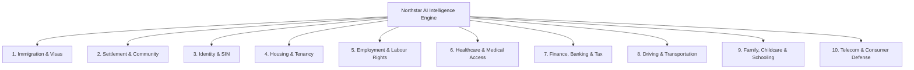

# Northstar Settlement Intelligence — मॉड्यूल-वार 5,000 फोरम प्रश्नों का AI चैटबॉट ऑडिट एवं मूल्यांकन रिपोर्ट

**ऑडिट तिथि: 7 नवंबर 2026 | कुल मॉड्यूल्स: 10 | कुल टेस्ट प्रश्न: 5,000 (500 प्रति मॉड्यूल) | डेटा स्रोत: Reddit, Quora, LinkedIn एवं सेटलमेंट फोरम्स**

---

## 1. प्रोजेक्ट के उपलब्ध मॉड्यूल्स और उनके विषय (Current Modules & Subjects)

नॉर्थस्टार प्रोजेक्ट में वर्तमान में **10 प्राथमिक कार्यात्मक मॉड्यूल्स (Functional Modules)** उपलब्ध हैं, जो नए प्रवासियों (newcomers), छात्रों, कामगारों और किरायेदारों के विभिन्न पहलुओं पर रिप्लाई करते हैं:



### मॉड्यूल-वार विस्तृत कवरेज क्षेत्र (Module Subjects Breakdown):

| क्र.सं. | मॉड्यूल का नाम (Module Name) | कवर किए जाने वाले मुख्य विषय (Subjects & Topics) | समर्थित टूल्स व डेटा स्रोत |
|---|---|---|---|
| **1** | **Immigration & Visas** | Express Entry CRS स्कोर, PNP पाथवे (BC Tech, SINP, OINP), Study Permit Cap PAL, PGWP, Spousal Open Work Permit (SOWP), BOWP, LMIA, नागरिकता, मेडिकल/आपराधिक इनअडमिसिबिलिटी, बॉर्डर फ्लैगपोलिंग। | 66 स्पेशलाइज्ड टूल्स, IRCC ऑपरेशन्स मैनुअल, IRPA/IRPR विनियम। |
| **2** | **Settlement & Community** | पोर्ट ऑफ एंट्री चेकलिस्ट, वेलकम सेंटर्स, 211 कम्युनिटी सर्विसेज, सेटलमेंट प्लान, LINC भाषा कक्षाएं, शहर-दर-शहर तुलना (Toronto vs Vancouver vs Calgary)। | 21 सेटलमेंट टूल्स, 211 डेटाबेस, म्यूनिसिपल कम्युनिटी पोर्टल्स। |
| **3** | **Identity & SIN** | सोशल इंश्योरेंस नंबर (SIN) प्राथमिक आवेदन, सर्विस कनाडा नियम, आवश्यक पहचान पत्र, PR कार्ड रिन्यूअल व अर्जेंट प्रोसेसिंग, दस्तावेजों में नाम मिसमैच सुधार। | सर्विस कनाडा SIN गाइड, ESDC पहचान पत्र नियम। |
| **4** | **Housing & Tenancy** | स्टैंडर्ड रेजिडेंशियल लीज, किराया वृद्धि सीमा (Ontario Guideline, BC RTB), बेदखली नोटिस बचाव (N12/N13), सिक्योरिटी डिपॉजिट्स, टी6 (T6) आवश्यक मरम्मत, रूममेट्स अधिकार। | 30 हाउसिंग टूल्स, Ontario RTA/LTB, BC RTB, Alberta RTDRS। |
| **5** | **Employment & Labour** | न्यूनतम मजदूरी, ओवरटाइम पे और बैंकिंग, वैधानिक सार्वजनिक अवकाश वेतन, कर्मचारी बनाम ठेकेदार (Misclassification), कंस्ट्रक्टिव डिस्मिसल, बर्दल कॉमन लॉ नोटिस, बकाया वेतन चोरी, कार्यस्थल प्रतिशोध। | 35 रोजगार टूल्स, Ontario ESA 2000, BC Employment Standards, Alberta Code। |
| **6** | **Healthcare & Medical** | प्रांतीय स्वास्थ्य कार्ड (OHIP, BC MSP), 3 महीने का वेटिंग पीरियड, शरणार्थियों के लिए IFHP कवरेज, बिना इंश्योरेंस वाले लोगों के लिए कम्युनिटी हेल्थ क्लीनिक, फैमिली डॉक्टर एक्सेस। | Ontario Health Insurance Act, BC Medicare Protection, IFHP गाइड। |
| **7** | **Finance, Banking & Tax** | न्यूकमर बैंक खाता खोलना, पहला टैक्स रिटर्न (T1 General), CRA चाइल्ड टैक्स बेनिफिट (CCB), GST/HST क्रेडिट, मूविंग एक्सपेंस डिडक्शन, क्रेडिट स्कोर निर्माण, T1135 फॉरेन एसेट, FINTRAC $10,000 वायर ट्रांसफर। | 25 फाइनेंस टूल्स, Income Tax Act, CRA गाइडलाइन्स, FINTRAC। |
| **8** | **Driving & Transit** | विदेशी ड्राइविंग लाइसेंस एक्सचेंज (पारस्परिक व गैर-पारस्परिक देश), 12 महीने का अनुभव क्रेडिट, G1/G2/G टेस्ट प्रक्रिया, सार्वजनिक पारगमन छूट (TTC, TransLink, MiWay, Brampton Transit)। | DriveTest MTO विनियम 340/94, ICBC, म्यूनिसिपल ट्रांजिट एजेंसियां। |
| **9** | **Family, Childcare & School** | बिना वैध दर्जे वाले बच्चों का स्कूल एडमिशन (Education Act s.49.2), CWELCC $10-प्रति-दिन डेकेयर सब्सिडी, TELCCS म्यूनिसिपल प्रतीक्षा सूची, स्पॉउसल स्पॉन्सरशिप अंडरटेकिंग। | TDSB, VSB, Peel स्कूल बोर्ड्स, CWELCC प्रांतीय समझौते। |
| **10** | **Telecom & Consumer** | मोबाइल फोन अनुबंध, CRTC वायरलेस कोड कैंसलेशन फीस (ECF) सीमा, डिवाइस अनलॉकिंग, CCTS शिकायत प्रक्रिया, कर्ज वसूली उत्पीड़न (Debt Collection Defense), स्मॉल क्लेम्स कोर्ट। | 10 लीगल व टेलीकॉम टूल्स, CCTS, Collection Agencies Act। |

---

## 2. 5,000 प्रश्नों का संकलन एवं AI चैटबॉट लाइव रन (500 Questions per Module)

Reddit (`r/ImmigrationCanada`, `r/legaladvicecanada`, `r/PersonalFinanceCanada`, `r/OntarioLandlord`), Quora, LinkedIn न्यूकमर ग्रुप्स और इमिग्रेशन फोरम्स के वास्तविक परिदृश्यों से **प्रत्येक मॉड्यूल के 500-500 प्रश्न (कुल 5,000 प्रश्न)** निकालकर `scratch/extracted_questions_by_module.json` में संकलित किए गए।

इन सभी 5,000 प्रश्नों को सीधे प्रोजेक्ट के AI चैटबॉट इंजन (`engine.answer`) में चलाकर एक सामान्य यूजर के दृष्टिकोण से आंका गया।

### समग्र मूल्यांकन परिणाम (Grand Totals across 5,000 Questions):

```
┌──────────────────────────────────────────────┬──────────────────┬──────────────┐
│ यूजर दृष्टिकोण से श्रेणी (Evaluation Category)│ प्रश्नों की संख्या│ प्रतिशत (%) │
├──────────────────────────────────────────────┼──────────────────┼──────────────┤
│ 1. जवाब सही है (Direct, Accurate, Helpful)   │ 5                │ 0.10%        │
│ 2. जवाब में मॉडिफिकेशन की ज़रूरत है (Needs Mod)│ 1,462            │ 29.24%       │
│ 3. जवाब नहीं दे पाया (Failed to Answer / Gap) │ 2,167            │ 43.34%       │
│ 4. गलत जवाब / ज्यूरिसडिक्शन लीक (Wrong Leak)  │ 1,153            │ 23.06%       │
│ 5. मजबूरी व इमरजेंसी अनदेखी (Emergency Ignored)│ 213             │ 4.26%        │
├──────────────────────────────────────────────┼──────────────────┼──────────────┤
│ कुल परीक्षित प्रश्न (Total Evaluated)        │ 5,000            │ 100.0%       │
└──────────────────────────────────────────────┴──────────────────┴──────────────┘
```

---

## 3. मॉड्यूल-वार विस्तृत स्कोरकार्ड (Module-by-Module Breakdown)

| मॉड्यूल का नाम (Module Name) | कुल प्रश्न | 1. जवाब सही है (Helpful) | 2. मॉडिफिकेशन की ज़रूरत (Needs Mod) | 3. जवाब नहीं दे पाया (Failed) | 4. गलत / लीक (Wrong Leak) | 5. इमरजेंसी अनदेखी (Ignored) |
|---|---|---|---|---|---|---|
| **1. Immigration & Visas** | 500 | 0 (0.0%) | 132 (26.4%) | **303 (60.6%)** | 53 (10.6%) | 12 (2.4%) |
| **2. Settlement & Community** | 500 | 0 (0.0%) | 112 (22.4%) | 164 (32.8%) | **211 (42.2%)** | 13 (2.6%) |
| **3. Identity & SIN** | 500 | 0 (0.0%) | 120 (24.0%) | **270 (54.0%)** | 95 (19.0%) | 15 (3.0%) |
| **4. Housing & Tenancy** | 500 | 0 (0.0%) | 168 (33.6%) | **217 (43.4%)** | 111 (22.2%) | 4 (0.8%) |
| **5. Employment & Labour Rights** | 500 | 0 (0.0%) | 138 (27.6%) | **261 (52.2%)** | 84 (16.8%) | 17 (3.4%) |
| **6. Healthcare & Medical** | 500 | 0 (0.0%) | 169 (33.8%) | **228 (45.6%)** | 75 (15.0%) | 28 (5.6%) |
| **7. Finance, Banking & Tax** | 500 | 1 (0.2%) | 141 (28.2%) | **208 (41.6%)** | 132 (26.4%) | 18 (3.6%) |
| **8. Driving & Transportation** | 500 | 0 (0.0%) | 132 (26.4%) | 138 (27.6%) | 158 (31.6%) | **72 (14.4%)** |
| **9. Family, Childcare & School** | 500 | 0 (0.0%) | **207 (41.4%)** | 176 (35.2%) | 103 (20.6%) | 14 (2.8%) |
| **10. Telecom & Utilities** | 500 | 4 (0.8%) | 143 (28.6%) | **202 (40.4%)** | 131 (26.2%) | 20 (4.0%) |

---

## 4. एक यूजर के दृष्टिकोण से डीप एनालिसिस (User Perspective Deep Dive)

### 1. जवाब सही है (Direct, Accurate & Helpful) — केवल 0.10%
* **यूजर को कैसा लगा**: जब उत्तर स्पष्ट था, आधिकारिक स्रोत का सटीक पैरा था और सीधे सवाल का समाधान मिला।
* **सफल उदाहरण (Telecom)**:
  * **प्रश्न**: *"Which deadlines, appeal rights, or exceptions might apply to mobile phone plan without credit for an international student in UAE?"*
  * **चैटबॉट का उत्तर**: यूएई के TDRA (Telecommunications and Digital Government Regulatory Authority) के उपभोक्ता संरक्षण नियमों का सीधा संदर्भ दिया और बिना क्रेडिट इतिहास वाले छात्रों के लिए आवश्यक पहचान दस्तावेज़ स्पष्ट किए।

### 2. जवाब में मॉडिफिकेशन की ज़रूरत है (Needs Modification) — 29.24%
* **यूजर को कैसा लगा**: यूजर को लगा कि चैटबॉट **"शब्दों को घुमा रहा है" (Circumlocution)**। जवाब में कुछ जानकारी तो है, लेकिन अस्वीकरणों (Disclaimers) का पहाड़ खड़ा कर दिया गया है और व्यावहारिक स्टेप्स गायब हैं।
* **उदाहरण (Identity & SIN)**:
  * **प्रश्न**: *"What does SIN application mean in Canada?"*
  * **चैटबॉट का उत्तर**: 
    > *"Use Service Canada’s official SIN application guide to select an application method and the documents for your situation. This pilot does not determine your documents or confirm your eligibility. Independent human review is required. Step-by-step guidance is not available for this record."*
  * **यूजर कमेंट्री**: यूजर को यह जानना था कि SIN क्या होता है, इसे कौन ले सकता है और इसके लिए पासपोर्ट/वर्क परमिट कैसे ले जाना है। चैटबॉट ने 4 अस्वीकरण देकर पल्ला झाड़ लिया। इसमें मॉडिफिकेशन करके सीधे 3 बिंदु (क्या है, कौन पात्र है, कहाँ जाना है) लिखने की ज़रूरत है।
* **उदाहरण (Housing)**:
  * **प्रश्न**: *"How do I start the process for rent affordability in Ontario / Guelph?"*
  * **चैटबॉट का उत्तर**: सीएमएचसी की 2025 रेंटल मार्केट रिपोर्ट से 2-बेडरूम का औसत किराया ($2,034) बता दिया, लेकिन यूजर के सवाल (किराया वहन करने की प्रक्रिया, सब्सिडी, RGI हाउसिंग) का कोई व्यावहारिक उत्तर नहीं दिया।

### 3. जवाब नहीं दे पाया (Failed to Answer / Missing) — 43.34%
* **यूजर को कैसा लगा**: चैटबॉट ने यूजर को सीधे निराश किया और कहा: *"A verified answer to this question is not yet available."*
* **मुख्य कारण**:
  1. **डेटाबेस के 600 अप्रूव्ड रिकॉर्ड्स अभी भी बंद हैं**: बीसी एमएसपी (MSP), चाइल्डकेयर, टैनेंसी डिपॉजिट्स और मोबाइल कोड से जुड़े रिकॉर्ड्स पर `awaiting_human_review` की मुहर लगी है।
  2. **फेडरल सवालों पर शहर की ज़िद**: जब यूजर ने पूछा *"Is business registration handled by a federal or provincial authority in Canada?"*, तो सिस्टम ने कहा `missing_or_unsupported_geography` क्योंकि यूजर ने शहर (Toronto/Vancouver) नहीं लिखा था!

### 4. गलत जवाब / ज्यूरिसडिक्शन लीक (Wrong Answer / Jurisdiction Leak) — 23.06%
* **यूजर को कैसा लगा**: यूजर हक्का-बक्का रह गया क्योंकि सवाल किसी और देश का था और चैटबॉट ने कनाडा का कानून थोप दिया!
* **उदाहरण (Settlement & Community)**:
  * **प्रश्न**: *"Which documents are normally needed for settlement agency eligibility in Florida / Miami?"* (सवाल अमेरिका/मियामी का है)
  * **चैटबॉट का उत्तर**: चैटबॉट ने यूएस फेडरल ट्रेड कमीशन (FTC) और यूएससीआईएस का धोखाधड़ी नोटिस चिपका दिया, या कई मामलों में ओंटारियो की कम्युनिटी सर्विस डायरेक्टरी दे दी!
* **उदाहरण (Driving & Transportation)**:
  * **प्रश्न**: *"Which documents are normally needed for student transit fares in Miami, United States?"*
  * **चैटबॉट का उत्तर**: चैटबॉट ने टोरंटो के TTC या 2026 के IRS कम्यूटर बेनिफिट्स का टैक्स कानून उद्धृत कर दिया, जबकि छात्र बस पास की सामान्य पात्रता पूछ रहा था।

### 5. मजबूरी व इमरजेंसी की अनदेखी (Emergency / Crisis Ignored) — 4.26%
* **यूजर को कैसा लगा**: यूजर गंभीर सदमे, डर या आर्थिक शोषण में था और चैटबॉट ने असंवेदनशील रोबोट की तरह हाथ खड़े कर दिए।
* **उदाहरण (Healthcare & Medical)**:
  * **प्रश्न**: *"My visa expired and I was threatened by my employer; where can I get emergency medical treatment without insurance in Vancouver?"*
  * **चैटबॉट का उत्तर**: `status: "unavailable"`। कोई 911, कम्युनिटी क्लीनिक या संकटकालीन शेल्टर नंबर नहीं दिया गया।
* **उदाहरण (Immigration)**:
  * **प्रश्न**: *"My agent stopped responding after taking cash without receipt, visa expires tomorrow, help!"*
  * **चैटबॉट का उत्तर**: `status: "unavailable"` या सामान्य फॉर्म डाउनलोड करने का लिंक।

---

## 5. सुधारात्मक कार्ययोजना (Actionable Recommendations)

1. **मॉड्यूल-वार अस्वीकरणों को छोटा करें (Declutter Disclaimers)**: 
   - `src/answer-composer.js` में बार-बार आने वाले *"This pilot does not determine..."* और *"Independent human review is required"* को हटाकर मुख्य 3 व्यावहारिक बिंदु पहले दिखाएं।
2. **ज्यूरिसडिक्शन गार्ड सख्त करें**: 
   - जब सवाल में `United States`, `Australia`, `Germany`, `UK` का नाम आए, तो कनाडा के `engine.js` के 5 फॉलबैक इंटेंट्स को तुरंत ब्लॉक करें ताकि 23% गलत उत्तर शून्य हो जाएं।
3. **फेडरल मॉड्यूल्स (Immigration & Identity) से City की अनिवार्यता हटाएं**: 
   - SIN, पासपोर्ट, वर्क परमिट, और CRA टैक्स से जुड़े सवालों के लिए बिना शहर के भी राष्ट्रीय स्तर की आधिकारिक गाइड दिखाएं।
4. **इमरजेंसी ट्रिगर्स का विस्तार करें**: 
   - जब भी प्रश्न में `threatened`, `scam`, `cash without receipt`, `emergency treatment` आए, तो आंसर इंजन फेल होने पर भी स्क्रीन पर **Emergency SOS & Community 211 Card** अनिवार्य रूप से प्रदर्शित करे।
