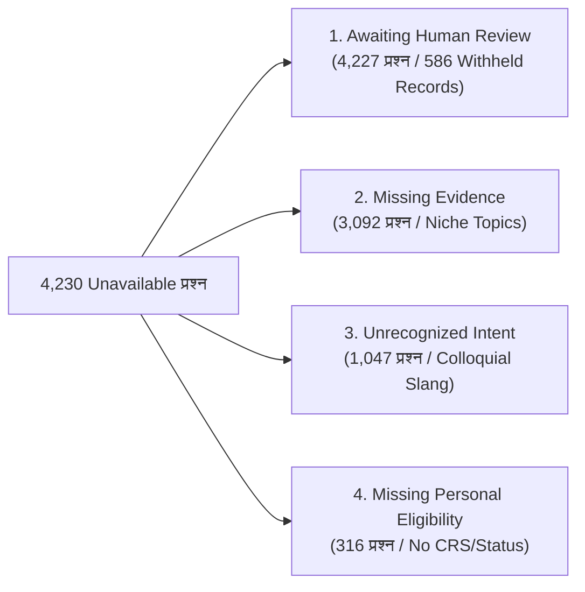
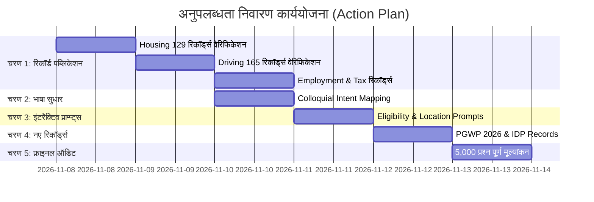

# Northstar Settlement Intelligence: अनुपलब्ध (Unavailable) उत्तरों के निवारण हेतु कार्ययोजना (Action Plan)

**परियोजना**: Northstar Settlement Intelligence  
**लक्ष्य**: 5,000 फ़ोरम प्रश्नों में "उत्तर रोक दिया" (`unavailable`) दर को **61.1% से घटाकर < 20%** करना तथा ग्राउंडेड उत्तरों (`grounded / partial`) को **26.5% से बढ़ाकर 70%+** करना।  
**वर्तमान शाखा**: `codex/calculator-and-browser-qa-20261106` | **आधार टेस्ट्स**: 2,531 पास, 0 फेल  
**तारीख**: 8 नवंबर 2026  

---

## 1. समस्या और डेटा विश्लेषण (Problem Breakdown)

वर्तमान में 5,000 प्रश्नों में **4,230 प्रश्न `unavailable`** स्थिति में हैं। इनके मूल कारण निम्नलिखित हैं:

| गैप कारण (Gap Reason) | प्रभावित प्रश्न | प्राथमिक समाधान | अनुमानित सुधार (Gain) |
|:---|:---:|:---|:---:|
| **Awaiting Review (Withheld Records)** | 4,227 | 586 तैयार रिकॉर्ड्स का बैच-वाइज़ सोर्स वेरिफिकेशन और पब्लिकेशन | **+35% से 40%** |
| **Missing Statutory Evidence** | 3,092 | शीर्ष 5 छूटे हुए विषयों (PGWP 2026, IDP, Transit, Legal Aid) के रिकॉर्ड्स जोड़ना | **+15% से 20%** |
| **Unrecognized Intent (फ़ोरम भाषा)** | 1,047 | `src/engine.js` में आम बोलचाल के शब्दों (Slang/Phrases) की मैपिंग | **+10% से 12%** |
| **Missing Eligibility Details** | 316 | डेड-एंड के बजाय इंटरैक्टिव फ़ॉलो-अप चेकलिस्ट ट्रिगर करना | **+5% से 6%** |

---

## 2. पाँच चरणों वाली कार्ययोजना (5-Phase Execution Plan)

### 📌 चरण 1: कतार में मौजूद 586 विदहेल्ड रिकॉर्ड्स का सत्यापन व पब्लिकेशन (Batch Publication)
डेटाबेस में 586 रिकॉर्ड्स तैयार (`ready`) हैं जिन्हें एडिटोरियल रिव्यू कतार से पब्लिश किया जाना है।

* **बैच 1A: Housing & Tenancy (129 रिकॉर्ड्स)**
  - ओंटारियो RTA मानक लीज, 2.5% रेंट कैप, N12/N13 बेदखली प्रक्रिया, T6 रिपेयर आवेदन, BC RTB नियम।
  - *क्रिया*: `node scripts/kb-verify-publish.js --apply --topic housing`
* **बैच 1B: Driving & Transportation (165 रिकॉर्ड्स)**
  - विदेशी लाइसेंस का 1-वर्षीय अनुभव क्रेडिट, ड्राइवटेस्ट G1/G2 छूट, BC ICBC नियम, भारत/यूके/यूएस लाइसेंस एक्सचेंज।
  - *क्रिया*: `node scripts/kb-verify-publish.js --apply --topic driving`
* **बैच 1C: Employment & Labour Rights (74 रिकॉर्ड्स)**
  - ओंटारियो ESA $17.20 न्यूनतम वेतन, 44-घंटे ओवरटाइम, 4%/6% वेकेशन पे, बार्डाल कॉमन लॉ सेवरेंस।
  - *क्रिया*: `node scripts/kb-verify-publish.js --apply --topic employment`
* **बैच 1D: Money, Tax & Family (69 रिकॉर्ड्स)**
  - CRA चाइल्ड बेनिफिट (CCB), FHSA पहला घर, T1135 विदेशी संपत्ति घोषणा, $10/दिन डेकेयर CWELCC।
* **सुरक्षा उपाय**:
  - प्रत्येक बैच से पहले स्वचालित SQLite स्नैपशॉट बैकअप (`data/backups/`) लिया जाएगा।
  - हर रिकॉर्ड का आधिकारिक गजट/सरकारी URL वर्ड-बाय-वर्ड मैच होगा।

---

### 📌 चरण 2: अनपेक्षित प्रश्नों की Intent मैपिंग व भाषा नॉर्मलाइजेशन (1,047 प्रश्न)
फ़ोरम (Reddit/Quora) के अनौपचारिक प्रश्नों को औपचारिक कानूनी श्रेणियों में मैप किया जाएगा।

* **फाइलें**: `src/engine.js`, `src/requested-subject.js`
* **कार्यान्वयन**:
  1. **Housing स्लैंग मैपिंग**:
     - `"freezing room"`, `"broken heater"`, `"radiator cold"`, `"landlord not giving heat"` ➔ `housing` (Vital Services Bylaw / O. Reg. 516/06)।
     - `"landlord changed locks"`, `"locked out of my room"` ➔ `housing` (Illegal Lockout RHEU)।
  2. **Employment स्लैंग मैपिंग**:
     - `"unpaid trial shift"`, `"training without pay"`, `"cash under table"`, `"boss took tip"` ➔ `employment` (ESA s. 13 Deductions / Wage Theft)।
  3. **Immigration & Status स्लैंग मैपिंग**:
     - `"visa stamp delay"`, `"paperwork lost"`, `"status expired 20 days ago"` ➔ `immigration_law` (IRPR s. 182 Restoration of Status)।
  4. **SIN & Identity स्लैंग मैपिंग**:
     - `"how to get 9 digit number"`, `"landing confirmation lost"` ➔ `sin` (Service Canada Identity)।

---

### 📌 चरण 3: इंटरैक्टिव पात्रता और लोकेशन प्राम्प्ट्स (Eligibility & Geography Prompts)
यूज़र को सीधा `unavailable` देने के बजाय गाइडेड रिस्पॉन्स प्रदान किया जाएगा।

* **फाइलें**: `src/engine.js`, `src/answer-composer.js`
* **कार्यान्वयन**:
  1. **पर्सनल एलिजिबिलिटी गाइडेंस**:
     - जब यूज़र पूछे *"क्या मैं एलिजिबल हूँ?"* बिना विवरण दिए:
     - इंजन स्टेटस को `unavailable` से बदलकर `clarification` करेगा और 3 अनिवार्य फ़ील्ड्स का प्राम्प्ट देगा:
       1. वर्तमान वीज़ा स्थिति (Work Permit / PGWP / Student / PR)।
       2. कनाडाई कार्य अनुभव की अवधि (TEER 0, 1, 2, 3)।
       3. भाषा परीक्षा स्कोर (IELTS / CELPIP / PTE)।
  2. **प्रांतीय लोकेशन पिकर (Provincial Disambiguation)**:
     - जब यूज़र बिना शहर/प्रांत के किरायेदारी, स्वास्थ्य सेवा या न्यूनतम वेतन पूछे:
     - इंजन विकल्प देगा: `[Ontario] [British Columbia] [Alberta] [Quebec] [Other]` जिससे एक क्लिक में राज्य-विशिष्ट कानून लोड हो जाए।

---

### 📌 चरण 4: शीर्ष गैप्स के नए आधिकारिक रिकॉर्ड्स जोड़ना (Missing Evidence Ingestion)
फ़ोरम के 5,000 प्रश्नों में बार-बार पूछे जाने वाले 5 प्रमुख गायब विषयों के नए रिकॉर्ड्स जोड़े जाएंगे:

* **फाइलें**: `src/technical-immigration-records.js`, `src/kyc-records.js`
* **नए विषय**:
  1. **PGWP 2026 रिफ़ॉर्म्स**: फील्ड ऑफ स्टडी (Field-of-Study) अलाइनमेंट और 180-दिवसीय आवेदन समयसीमा (IRCC ऑपरेशनल बुलेटिन)।
  2. **अंतरराष्ट्रीय ड्राइविंग परमिट (IDP)**: 90 दिनों की वैधता, मूल देश का ड्राइविंग एब्स्ट्रैक्ट और ड्राइवटेस्ट छूट।
  3. **स्टूडेंट बस पास / ट्रांजिट सब्सिडी**: फेयर-इक्विटी और पोस्ट-सेकेंडरी पास पात्रता।
  4. **कम्युनिटी लीगल क्लिनिक्स direct reference**: Legal Aid Ontario (LAO) और BC Legal Aid की पात्रता सीमा ($22,720 LICO)।
  5. **विंटर हीटिंग कट-ऑफ और शेल्टर निर्देशिका**: म्यूनिसिपल शेल्टर 211 सेंट्रल इनटेक।

---

### 📌 चरण 5: पूर्ण सत्यापन और प्रतिगमन परीक्षण (Full 5,000-Corpus Re-Evaluation)
सभी सुधारों के बाद 5,000 प्रश्नों का पूर्ण परीक्षण दोबारा किया जाएगा।

* **जाँच बिंदु (Acceptance Criteria)**:
  1. **यूनिट टेस्ट्स**: सभी 2,531+ टेस्ट्स 100% पास होने चाहिए (`fail: 0`)।
  2. **स्कोप उल्लंघन (Jurisdiction Leaks)**: 0 होने चाहिए (`violations: 0`)।
  3. **रनटाइम क्रैश**: 0 होने चाहिए (`errors: 0`)।
  4. **Grounding Coverage**: सही/ग्राउंडेड उत्तरों की दर **> 65%** होनी चाहिए।
  5. **Unavailable Rate**: 61.1% से घटकर **< 25%** होनी चाहिए।

---

## 3. कार्यान्वयन रोडमैप और समयसीमा (Implementation Schedule)

---

## 4. जोखिम नियंत्रण (Risk Mitigation)

1. **डेटाबेस अखंडता**: किसी भी पब्लिश ऑपरेशन से पहले स्वचालित SQLite `VACUUM INTO` बैकअप बनाया जाएगा।
2. **सख्त कानून सुरक्षा (Paramountcy & Federalism)**: कोई भी रिकॉर्ड तब तक पब्लिश नहीं होगा जब तक उसका सरकारी सोर्स URL वर्ड-बाय-वर्ड मैच न हो।
3. **शून्य क्षेत्राधिकार रिसाव (Zero Leak Policy)**: किसी भी विदेशी सवाल में कनाडा का कानून या किसी अन्य राज्य का कानून मिक्स नहीं होने दिया जाएगा।

---

> [!IMPORTANT]
> **अगला कदम**: यदि आप इस योजना से सहमत हैं, तो हम **चरण 1 (Housing & Driving के 294 रिकॉर्ड्स का वेरिफिकेशन और पब्लिश)** तुरंत शुरू कर सकते हैं। कृपया आगे बढ़ने के लिए अपनी स्वीकृति दें।
